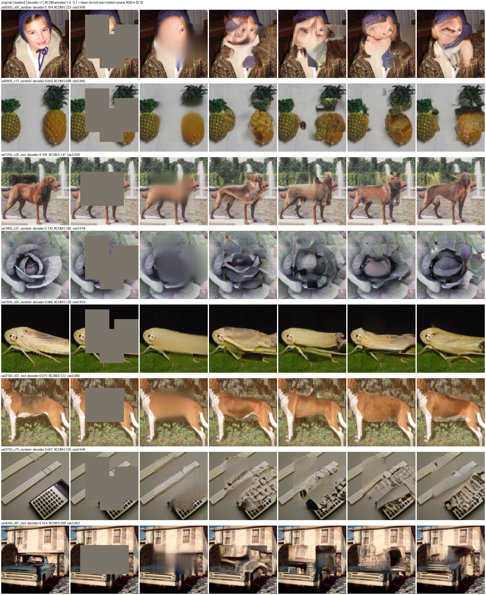
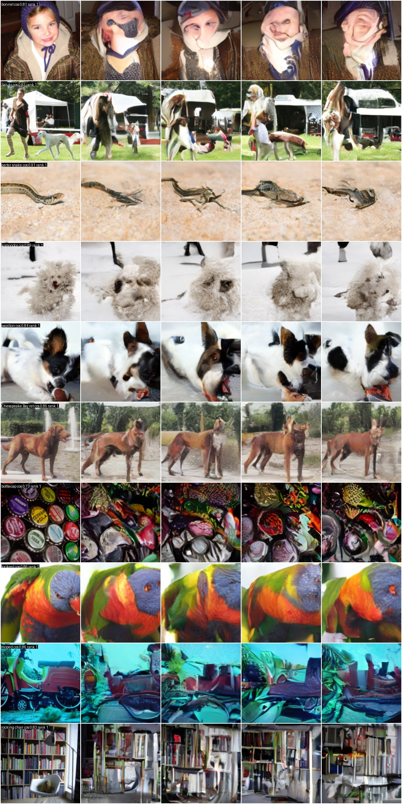
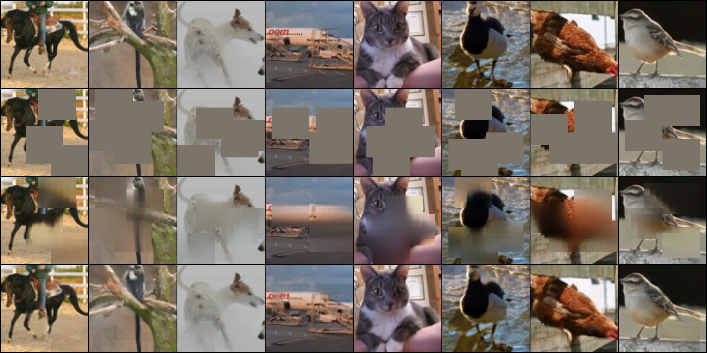

# I-JEPA from scratch: ViT-L/16 on ImageNet-100

A from-scratch PyTorch implementation of **I-JEPA** (Image-based Joint-Embedding Predictive Architecture, [Assran et al., CVPR 2023](https://arxiv.org/abs/2301.08243)), a self-supervised method that learns image representations by predicting the *embeddings* of masked image regions rather than their pixels.

- A **ViT-L/16** encoder (303M parameters) was pretrained for 150 epochs on ImageNet-100 on a single cloud H100. It reaches **60.0% weighted 20-NN** and **65.2% linear-probe** top-1 accuracy, against 8.7% and 17.0% for the same network untrained.
- Two **pixel-space visualizers** read the frozen features:
  - a deterministic masked-patch decoder;
  - an RCDM-style latent diffusion model, which generates several plausible fills per image.
- **A diagnostic experiment** shows that the blur in decoded fills comes from the predictor's features, not from the decoder.

<p align="center">
  
</p>

<sub>**Masked-image completion from frozen I-JEPA features** on ImageNet-100 validation images, which no model saw during training (the first validation image of 8 evenly spaced classes, not hand-picked). Columns: original | masked input | deterministic decoder | 4 RCDM samples. The row labels give the mean absolute error over hidden pixels (RGB in [0, 1]). Across these 8 images that error averages 0.110 for the decoder and 0.163 for the RCDM samples: the decoder predicts the average fill, the RCDM a sharp but different one. `cos` is the cosine between the RCDM's conditioning feature, built from the visible pixels only, and the full-image feature.</sub>

## Results

All numbers are measured on the 5,000-image ImageNet-100 validation set with the **target encoder**, using average-pooled patch tokens.

| Evaluation (frozen features) | ViT-L/16, 150 epochs | Same ViT-L, random init |
| --- | ---: | ---: |
| Weighted 20-NN accuracy (k = 20, T = 0.07) | **60.02%** | 8.66% |
| Linear probe, top-1 / top-5 | **65.24% / 88.00%** | 16.96% / 40.44% |

- **k-NN during training:** 48.82% (epoch 60), 52.94% (epoch 75), 59.04% (epoch 110), 59.78% (epoch 130), 60.02% (epoch 150).
- **Linear probe recipe:** the paper's (BatchNorm + linear head, LARS, batch 16,384, 50 epochs). The learning-rate sweep was extended upwards, and the setting was chosen on a held-out 10% of the training set. Features come from the evaluation transform, without probe-time augmentation.
- **Not comparable with the paper's ImageNet-1K numbers:** this run uses 100 classes at 160 px source resolution, batch 512 instead of 2,048, and 150 epochs.

| Visualizer (frozen ViT-L) | Result |
| --- | --- |
| Masked-patch decoder, 5,000 validation images with fixed masks | masked L1 **0.541** (ImageNet-normalised pixels); shuffled-feature control 1.160 |
| RCDM: is each sample recognisable as its source? (1,000 validation images × 4 samples) | **100%** top-1 retrieval of the source image among 5,000 validation features |
| RCDM: do samples keep the class? | k-NN class accuracy of samples **51.8%**, vs 61.0% for the real images (chance 1%) |

### What the representation keeps: RCDM samples

<p align="center">
  
</p>

<sub>Each row shows one ImageNet-100 validation image (the first of every 5th class), as the VAE reconstruction on the left, followed by 4 images generated from **only its average-pooled 1,024-d I-JEPA feature**. By eye, object type, colour, texture, pose and background are kept, so the representation encodes them; exact identity, faces and fine detail vary, so it does not. This follows the visualisation in the I-JEPA paper's Appendix E.</sub>

### Why the decoded fills are blurry: an oracle diagnostic

<p align="center">
  
</p>

<sub>Rows: original | masked input | fill decoded from the **predictor's** tokens | fill decoded from the **target encoder's** tokens of the hidden region (the "oracle", which sees the hidden pixels). The same decoder architecture and training budget are used for both, on an earlier ViT-S/16 I-JEPA trained on STL-10. Masked L1 is **0.531** from predicted tokens against **0.147** from oracle tokens (1,024 test images, fixed masks). A predicted-token decoder trained for 350k steps instead of 50k scored the same, 0.5305. The predictor encodes what is *predictable* about a hidden region (colour, layout, coarse shape) but not its pixel detail, which is the behaviour I-JEPA is designed to have.</sub>

## What is implemented

| Component | Where | Notes |
| --- | --- | --- |
| ViT encoder, EMA target encoder, narrow ViT predictor | `src/ijepa/model.py` | ViT-L/16: 1,024 wide, 24 blocks, 16 heads. Predictor: 384 wide, 12 blocks (22.1M parameters). No `[cls]` token; fixed 2-D sin-cos positional embeddings |
| Multi-block masking | `src/ijepa/masks.py` | 4 target blocks (scale 0.15–0.2, aspect 0.75–1.5) and 1 context block (scale 0.85–1.0) with the targets removed. Optionally sampled inside DataLoader workers; together with fewer GPU syncs this measured +9% throughput on an H100 |
| Latent-prediction objective | `src/ijepa/model.py` | L2 loss between predicted and LayerNorm'ed target-encoder embeddings; smooth-L1 option |
| Pretraining loop | `src/ijepa/train.py` | AdamW on the context encoder and predictor. LR warmup + cosine, weight decay 0.04→0.4, EMA momentum 0.996→1.0. Gradient accumulation, bf16 autocast, atomic resumable checkpoints, epoch snapshots, wall-clock budget stop |
| k-NN and linear-probe evaluation | `src/ijepa/evaluate.py`, `scripts/eval_vitl_snapshots.py`, `scripts/linear_probe_vitl.py` | Weighted k-NN and LARS linear probe on frozen features |
| Masked-patch decoder | `src/ijepa/decoder.py`, `train_decoder.py`, `evaluate_decoder.py` | Maps predicted target tokens to RGB patches with an L1 loss; predicted or oracle conditioning; held-out model selection and early stopping |
| RCDM-style visualizer | `src/ijepa/rcdm.py`, `rcdm_cache.py`, `train_rcdm.py`, `scripts/eval_rcdm.py` | Diffusers UNet (67.8M parameters) on 4×28×28 SD-VAE latents, conditioned on the pooled feature through scale/shift modulation; EMA weights; DDIM sampling |
| Completion CLI | `src/ijepa/complete.py` | Masks any image with random multi-block masks or a rectangle, then fills the hole with the decoder or with RCDM samples (blended DDIM inpainting, visible pixels kept exactly) |
| Cloud runner | `modal_app.py` | One [Modal](https://modal.com) function per action: data preparation, profiling, pretraining, decoder and RCDM training |
| Tests | `tests/test_core.py` | 36 CPU unit tests: mask validity, stop-gradient and EMA update, hand-computed losses, gradient accumulation, checkpoint, resume and snapshot rules, decoder, RCDM, k-NN, and the completion CLI (hidden pixels never leak into a completion) |

`docs/ARCHITECTURE.md` gives tensor shapes, every deviation from the paper, and known caveats. `docs/NEWCOMER_FAQ.md` explains the paper and this code as a series of questions.

### Pretraining setup (ViT-L/16)

| | This run | Paper (ImageNet-1K) |
| --- | --- | --- |
| Data | ImageNet-100 ([`clane9/imagenet-100`](https://huggingface.co/datasets/clane9/imagenet-100)): 126,689 training images, 160 px short side | ImageNet-1K |
| Augmentation | `RandomResizedCrop(224, scale 0.3–1.0)` only | No hand-crafted view augmentations; crop details not stated in the text |
| Batch size | 512 (2 × 256, gradient accumulation) | 2,048 |
| Learning rate | 1e-5 → 2.5e-4 (1e-3 × 512 / 2,048) over 1,852 steps, then cosine to 1e-6 | 1e-4 → 1e-3, then cosine |
| Schedule | 150 epochs = 37,050 steps, bf16, one H100 | 300 epochs for ablations |
| Loss | L2 on LayerNorm'ed targets, averaged over all elements | L2, summed per block and averaged over blocks (the same up to a constant factor) |

The run was trained in two halves on Modal and resumed exactly from a checkpoint in between. `configs/imagenet100_vitl16_l2_h100_b512_150ep.yaml` is the run's config; `..._ckpt10.yaml` is its continuation with a denser snapshot schedule.

## Quick start

```bash
pip install -r requirements.txt     # install a CUDA build of torch from pytorch.org first if you have a GPU
python -m unittest discover -s tests -v                  # 36 tests, CPU, under a minute
python -m src.ijepa.train --config configs/smoke.yaml    # 8-step pretraining run on synthetic images
```

**Data.** ImageNet-100 is read from the Hugging Face parquet shards:

```bash
huggingface-cli download clane9/imagenet-100 --repo-type dataset --local-dir data/imagenet-100
```

STL-10 is downloaded automatically into `data/` by torchvision.

**Training.** Every trainer is driven by one YAML file. Paths that start with `/vol/` refer to the Modal Volume; change them to local paths to run elsewhere. A ViT-L/16 needs about 50 GB of GPU memory at micro-batch 256, so it was trained on Modal.

```bash
python -m src.ijepa.train --config configs/<encoder>.yaml          # resumes from <output_dir>/latest.pt
python -m src.ijepa.train_decoder --config configs/<decoder>.yaml  # frozen encoder; geometry inherited from its checkpoint
python -m src.ijepa.rcdm_cache --encoder <encoder.pt> --split train --output <cache.pt>
python -m src.ijepa.train_rcdm --config configs/rcdm_imagenet100_vitl16.yaml

# On Modal (needs a Modal account and a Volume named ijepa-research)
modal run modal_app.py --action prepare-imagenet100
modal run --detach modal_app.py --action pretrain-vitl-b512-h100
```

**Evaluation.**

```bash
python scripts/eval_vitl_snapshots.py <epoch_NNN_weights.pt> --random-init   # weighted 20-NN
python scripts/linear_probe_vitl.py <epoch_NNN_weights.pt> --random-init     # linear probe
python -m src.ijepa.evaluate_decoder --encoder <encoder.pt> --decoder NAME=<decoder.pt> --output-dir <dir> --with-shuffled \
    --data-root data/imagenet-100/data --cache-dir data/hf_cache --examples 5000
python scripts/eval_rcdm.py --rcdm <rcdm.pt> --encoder <encoder.pt> --output-dir <dir>
```

The ImageNet-100 scripts read `data/imagenet-100/data` and `data/hf_cache` by default; pass `--data-root` and `--cache-dir` to change this.

**Complete your own image:**

```bash
# deterministic decoder, random I-JEPA masks or a rectangle given in original-image pixels
python -m src.ijepa.complete --image photo.jpg --encoder <encoder.pt> --decoder <decoder.pt> --output-dir out/ [--rect 30 30 120 120]
# several generative fills from the RCDM instead
python -m src.ijepa.complete --image photo.jpg --encoder <encoder.pt> --rcdm <rcdm.pt> --output-dir out/ --samples 4
```

It writes `original.png`, `masked.png`, the completion(s), a side-by-side `comparison.png` and `metadata.json`. Trained checkpoints are not included in this repository: the bf16 ViT-L weights alone are 1.26 GB.

## Repository layout

```
src/ijepa/      model, masks, data, training loops, evaluation, decoder, RCDM, completion CLI
scripts/        k-NN and linear-probe evaluation, RCDM evaluation, galleries, encoder visualisation
configs/        one versioned YAML per run (STL-10 ViT-S, ImageNet-100 ViT-L, decoder, RCDM, profiling)
tests/          unit tests (CPU)
docs/           architecture reference and FAQ
assets/         README figures
modal_app.py    Modal cloud-GPU entry points
```

On Windows, scripts must import `src.ijepa` (which imports `datasets`) before `torch`; the entry points already do this.

## References

- M. Assran et al. *Self-Supervised Learning from Images with a Joint-Embedding Predictive Architecture.* CVPR 2023. [arXiv:2301.08243](https://arxiv.org/abs/2301.08243)
- F. Bordes, R. Balestriero, P. Vincent. *High Fidelity Visualization of What Your Self-Supervised Representation Knows About.* TMLR 2022. [arXiv:2112.09164](https://arxiv.org/abs/2112.09164) (RCDM)
- [`stabilityai/sd-vae-ft-mse`](https://huggingface.co/stabilityai/sd-vae-ft-mse) (MIT), the latent autoencoder used by the RCDM visualizer, via [diffusers](https://github.com/huggingface/diffusers).

## License

The code is released under the MIT License (see `LICENSE`). ImageNet-100 is a subset of ImageNet and is subject to its non-commercial terms. The example images in `assets/` are from the ImageNet validation set and the STL-10 test set and belong to their respective owners.
